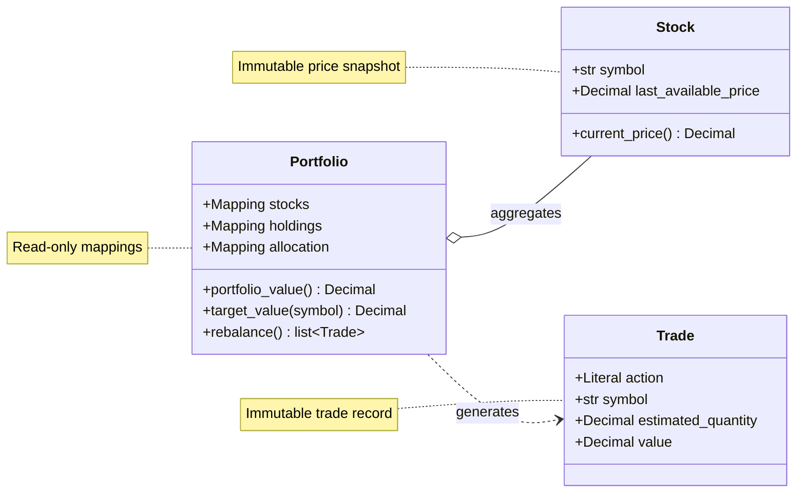

# Portfolio Rebalancer


A small Python 3 module that calculates which stocks to sell or buy to reach a
portfolio's target allocation. It returns a trade plan without modifying holdings
or executing orders. It uses only the Python standard library.

## Core Domain Model


## Run

Requires Python 3.10 or newer. From this directory:

```sh
python3 main.py
python3 -m unittest discover -v
```

The demo uses illustrative prices: 8 FTUL shares at 500, 16 MELI shares at 250,
and 20 NU shares at 100, for a total value of 10,000. To reach 60% FTUL,
20% MELI, and 20% NU, the plan is:

```text
Action  Stock       Estimated shares     Trade value
SELL    MELI                8.000000         2000.00
BUY     FTUL                4.000000         2000.00
```

The resulting holdings would be 12 FTUL shares worth 6,000, 8 MELI shares worth
2,000, and 20 NU shares worth 2,000 at the same reference prices. NU needs no
trade because it is already at its target weight.

## Interface

```python
from decimal import Decimal
from portfolio import Portfolio, Stock

portfolio = Portfolio(
    stocks=[
        Stock("FTUL", Decimal("500")),
        Stock("MELI", Decimal("250")),
        Stock("NU", Decimal("100")),
    ],
    holdings={"FTUL": Decimal("8"), "MELI": Decimal("16"), "NU": Decimal("20")},
    allocation={"FTUL": Decimal("0.60"), "MELI": Decimal("0.20"), "NU": Decimal("0.20")},
)

for trade in portfolio.rebalance():
    print(trade.symbol, trade.action, trade.value, trade.estimated_quantity)
```

- `Stock(symbol, last_available_price)` receives an externally supplied price.
  `current_price()` returns that immutable snapshot; it does not fetch market data.
- `Portfolio(stocks, holdings, allocation)` separates instruments and prices from
  owned quantities and target weights. The stock collection must include every
  symbol used in holdings or allocation, including stocks not yet owned.
- Holdings are share quantities. Allocation weights are fractions of total market
  value: `Decimal("0.60")` means 60%. Symbols are case-sensitive.
- `rebalance()` returns an immutable tuple of `Trade` objects. Each contains
  `symbol`, `action` (`SELL` or `BUY`), positive monetary `value`, and the
  `reference_price` used in the calculation. `estimated_quantity` is a calculated
  property. Sells come first; each action group is sorted by symbol.
- Inputs are defensively copied and exposed through read-only mappings. Stocks,
  portfolios, and trades are immutable. Repeated calls on the same snapshot return
  the same plan, independently of input ordering.

## Calculation

For every symbol appearing in holdings or allocation:

```text
current_value = owned_quantity * current_price
total_value   = sum(current_values)
target_value  = total_value * target_weight
difference    = target_value - current_value
```

A positive difference produces a buy; a negative difference produces a sell.
Zero produces no trade. A missing holding means zero shares; a missing allocation
means zero target weight, so an existing position outside the allocation is sold
entirely. A portfolio with no holdings returns an empty plan when its target
allocation is valid. Calculations use market value rather than share counts.

Valuation and trade calculation take O(n) time; deterministic sorting takes
O(n log n) time. Space usage is O(n).

## Precision and validation

Prices, quantities, and weights must be finite `Decimal` instances. Construct
them from strings to preserve their intended values. Floats, integers, and strings
passed directly as numerical inputs raise `TypeError`.

Prices must be positive; quantities must be nonnegative. Weights must lie between
0 and 1 and sum exactly to 1. Empty allocations, duplicate stock symbols, unknown
symbols, empty symbols, and symbols with surrounding whitespace are rejected with
`ValueError`. Allocation weights are never silently normalized. Zero weights and
zero holdings are allowed. Short positions are unsupported.

Monetary operations use a private decimal context with 50 significant digits and
an `Inexact` trap. They return exact finite-decimal results within that precision
budget; an operation requiring rounding raises `decimal.Inexact`. Other decimal
range errors propagate as decimal exceptions. The caller's decimal precision,
rounding, and trap settings do not affect the calculation or get changed by it.
No currency-cent rounding or minimum trade threshold is applied: even small
nonzero monetary differences appear in the plan.

`Trade.value` is the authoritative monetary recommendation. Its
`estimated_quantity` divides that value by the reference price using 50 significant
digits and `ROUND_HALF_EVEN`; decimal underflow raises `decimal.Underflow` rather
than silently returning zero. Some fractions, such as one third of a share, cannot
be represented exactly by a finite decimal. Monetary buys and sells conserve
value exactly within the accepted calculation precision; multiplying rounded
share estimates back by prices can leave a small residual. The demo rounds only
its displayed numbers.

## Assumptions and limits

The model assumes a single currency, fixed reference prices, fractional shares,
no existing cash, no deposits or withdrawals, and no fees or taxes. There is no
broker-specific share increment. Exact target weights are achievable in the
ideal mathematical model; finite share estimates are not executable orders or a
guarantee of sufficient buying power after broker rounding.

An execution layer would need fresh prices and holdings, supported share
increments, explicit residual cash, costs, available funds, and order lifecycle
handling. Those concerns are deliberately outside this exercise. Recomputing from
holdings obtained by applying rounded share estimates may reveal a tiny remaining
deviation; the planner does not hide it with an arbitrary tolerance.

The tests cover ordinary and boundary cases, invalid inputs, deterministic output,
immutable snapshots, precision behavior, and value-conservation properties.

## Agentic SDLC

Act as an end-to-end software development agent. Implement the following requirement in Python 3:

“You’re building a portfolio management module, part of a personal investments and trading app. Construct a simple Portfolio class that has a collection of Stocks. Assume each Stock has a ‘Current Price’ method that receives the last available price. The Portfolio also has an allocation representing its target stock distribution. Provide a rebalance method that determines which stocks should be sold and bought to reach that allocation.”

Work in this order:

1. Write a concise docs/RFC.md before changing application code. Define the Stock, Portfolio, allocation, and trade-plan contracts; explain assumptions about prices, cash, fractional shares, precision, and rounding. Include testable acceptance criteria.
2. Implement the RFC with a small, standard-library-only solution. Use Decimal for financial calculations. Keep the rebalance method deterministic and free of trading side effects. Validate invalid prices, quantities, symbols, and allocations.
3. Use FTUL 60%, MELI 20%, and NU 20% in the runnable example and README. Use NVDA in a test for a holding outside the target allocation.
4. Add meaningful tests for the expected trades, an already balanced portfolio, missing and unallocated holdings, invalid inputs, precision, determinism, and value conservation. Run the example and the full test suite.
5. Investigate any failure, fix its cause, and rerun the affected checks. Then verify each RFC acceptance criterion against the implementation and test results.
6. Update the README with setup instructions, an example, design decisions, and limitations.
7. Report the files changed, commands run and their results, acceptance criteria verified, and any remaining limitations.

Write all code, documentation, test names, and code comments in English. Keep comments minimal and prefer clear names. Keep the solution proportional to this small exercise. Do not change requirements merely to make tests pass. Do not claim success without verification evidence. Do not deploy or publish anything.